.. _configuration:

Configuration
-------------

This guide explains how to configure KegMon through its web interface. Access the device via a web browser using its IP address or mDNS name (e.g., kegmon.local). The interface is divided into sections for device settings, taps, integrations, and tools.

Index
*****

The main dashboard displays general device information, including temperatures and status. Only available data is shown.

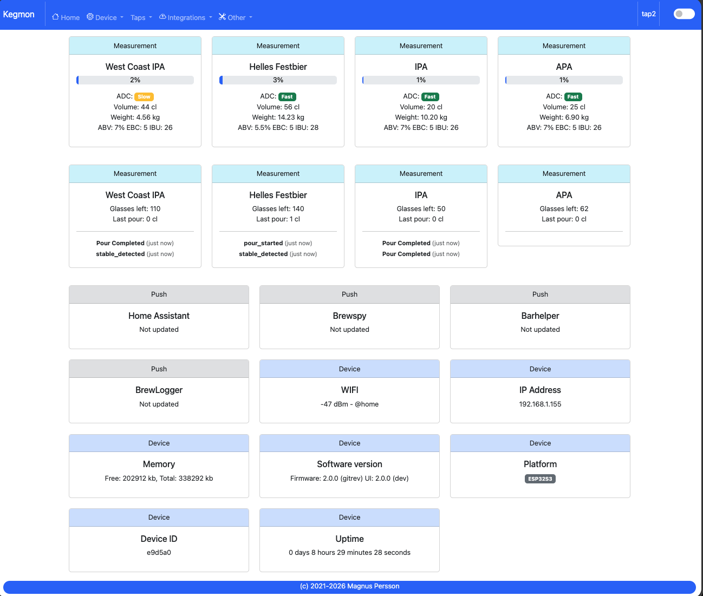

Device - Settings
*****************

Configure general device preferences here.

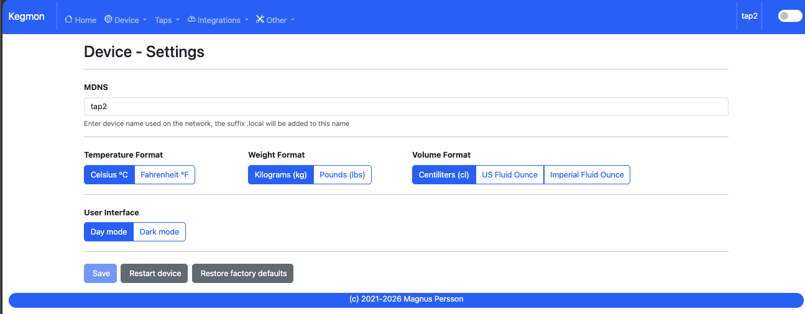

* **MDNS**: Set a custom name for the device on the network (requires mDNS support).
* **Temperature format**: Choose Celsius or Fahrenheit for temperature display.
* **Weight unit**: Select kg or lbs for weight measurements.
* **Volume unit**: Choose cl, UK fl. oz, or US fl. oz for volume display.
* **Dark Mode**: Toggle between light and dark UI themes (also available via the menu bar).

Device - Calibration
********************

Calibrate your scales in three easy steps for accurate weight measurements.

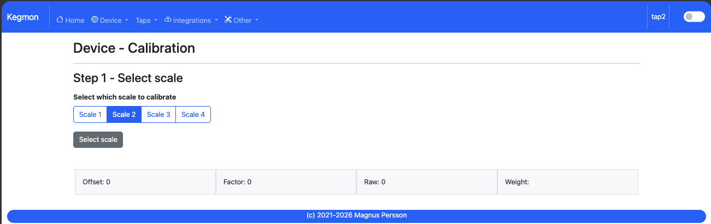

* **STEP 1 - Tare scale**: Select the scale from the dropdown and ensure it's empty, then tare to zero.
* **STEP 2 - Calculate factor**: Place an object of known weight on the scale and enter its weight. The software calculates the calibration factor.
* **STEP 3 - Validate**: Place another object of known weight and verify the reading. If accurate, calibration is complete.

Device - Statistics
********************

Inspect scale readings, filtering, state, and current-session statistics to
diagnose the hardware and change-detection behavior.

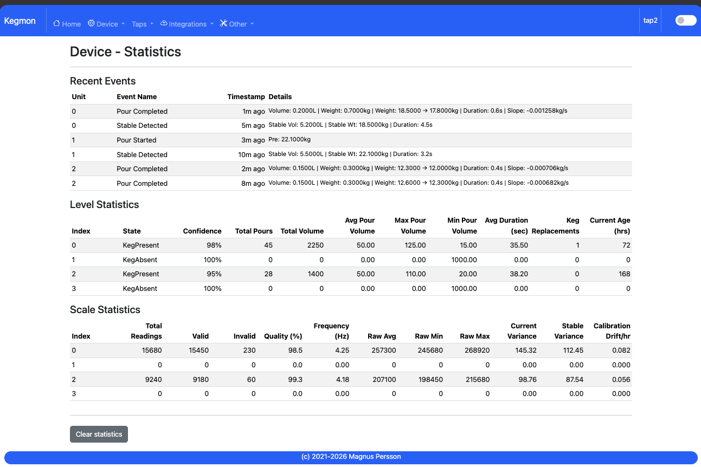

This page helps diagnose unstable builds. Keep it open to view the live chart of
raw, filtered, and stable values; chart history is held in the browser and is
cleared when the page is refreshed. The statistics API also reports state
transitions and scale quality metrics.

Device - Events
***************

The Events page displays CSV event history when an SD card is mounted. Select a
scale filter and use **Refresh Data** to load the stored events. The dashboard
also shows recent events held in memory for the current session; this recent
list is separate from the SD-card history.

SD logging is available only in firmware builds that enable the card interface.
The logger writes event records to ``/data.csv``, rotates at roughly 16 KB, and
keeps up to four files (``data.csv`` through ``data3.csv``). Without a mounted
card, live monitoring continues but persistent event history is unavailable.

Device - WiFi
*************

Manage WiFi connections and settings.

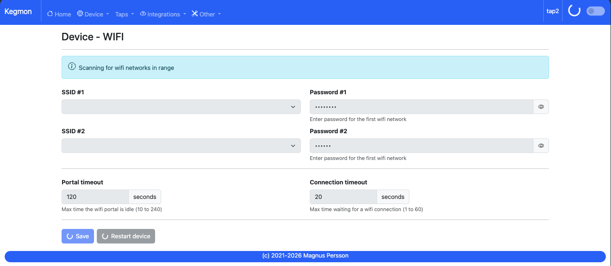

* **SSID #1/Password #1**: Primary network credentials.
* **SSID #2/Password #2**: Secondary network for fallback (optional).
* **Portal timeout**: Time (in seconds) the WiFi portal remains active when triggered (e.g., by tapping reset 2-3 times within 3 seconds).
* **Connect timeout**: Maximum time allowed for WiFi connection attempts.

Taps - Settings
***************

Configure individual tap settings for volume calculations and beer details.

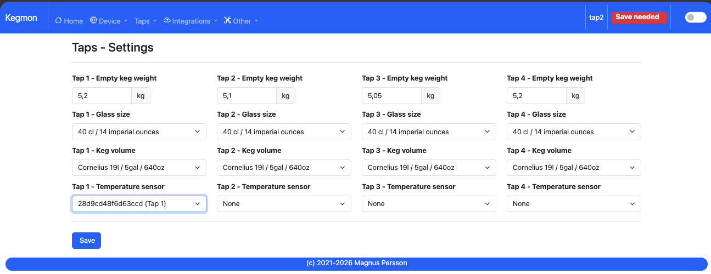

* **Empty keg weight**: Weight of the empty keg, used to calculate remaining beer volume.
* **Glass volume**: Standard glass size for estimating remaining pours.
* **Keg volume**: Standard keg size for validating weight and calculating remaining volume.
* **Temperature sensor**: Assign a detected DS18B20 sensor ID to the tap. The
  sensors share a OneWire bus; an unassigned tap falls back to the first sensor
  value when one is available.

Taps - Beers
************

View and manage beers on tap, with options to import from integrations.

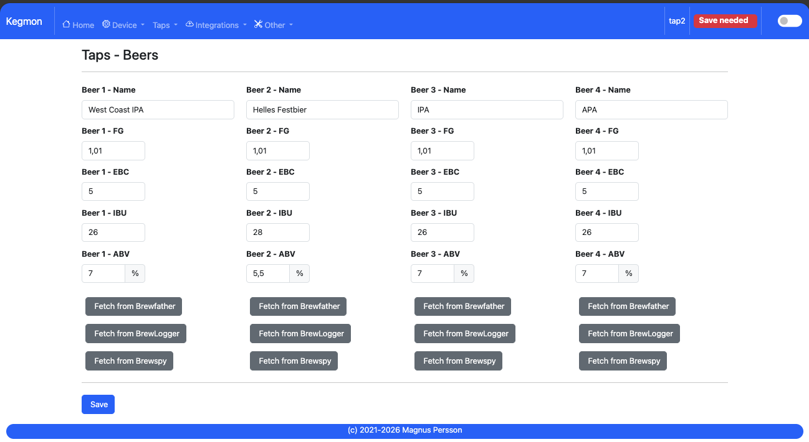

Use the per-tap buttons to import beer details from configured BrewSpy,
Brewfather, BrewLogger, or BrewGraph integrations. Available fields depend on
the service response; the app can populate name, FG, EBC, ABV, and IBU where
provided.

Taps - History
**************

Review recent pour history for each tap.

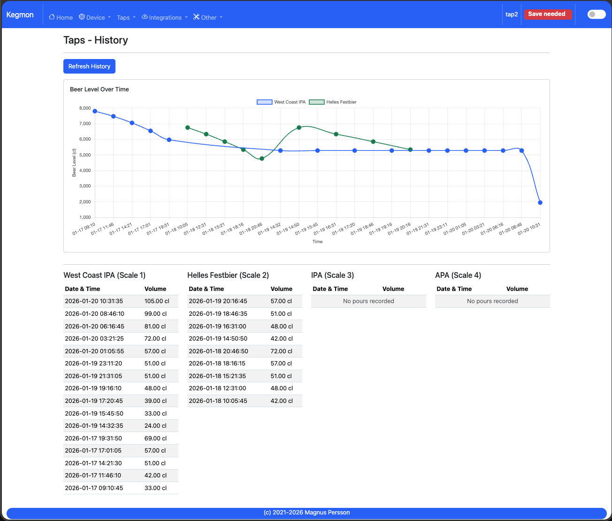

Displays recent completed pours for each tap from the event history.

Integration - Home Assistant
****************************

Set up MQTT for Home Assistant integration.

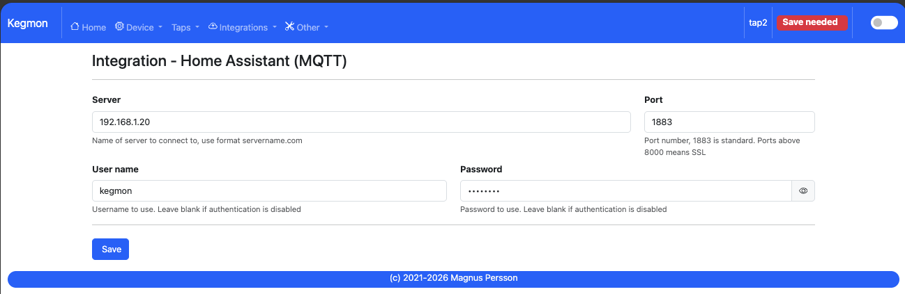

Configure MQTT server details for data export to Home Assistant.
KegMon publishes measurement updates and state transitions for configured
scales. This can include a notification when a scale enters **Pouring**, as
well as stable-level and fault/recovery state events. Use the matching MQTT
topics and payloads configured by KegMon when creating Home Assistant sensors
or automations.

Integration - Brewfather
************************

Connect to Brewfather for brew data import.

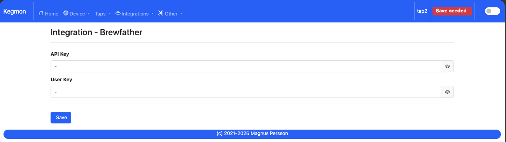

Enter API and user keys for Brewfather access.

Integration - Brewspy
*********************

Link to BrewSpy for keg and beer data.

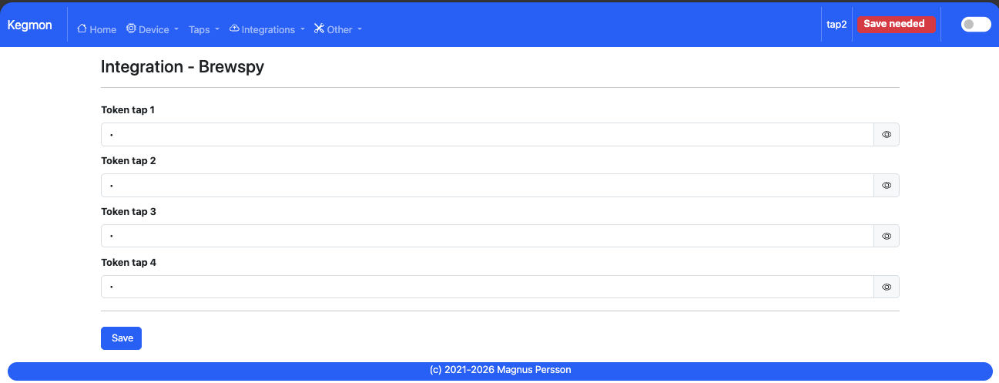

Enter tokens for kegs. Copy the webhook URL code from BrewSpy and paste it here.

Integration - Barhelper
***********************

Integrate with Barhelper for additional monitoring.

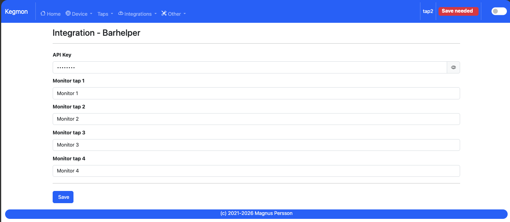

Enter API keys and monitor names. Obtain the key from Barhelper settings (save it securely, as it's not retrievable later). Monitors are added automatically on first run.

Integration - BrewLogger
************************

Enter the BrewLogger base URL. KegMon sends stable volume and pour information
to the configured service, and can request beer information from the tap beer
page.

Integration - BrewGraph
************************

Open **Integrations → BrewGraph** and enter the service base URL plus one token
for each keg. KegMon sends stable keg-volume and pour updates using the token
for that scale. The **Taps → Beers** page can also fetch beer name, ABV, IBU,
and EBC from BrewGraph. The four token fields correspond to the four supported
scale slots; they do not represent additional features beyond the four
physical HX711 inputs.

When saving, trailing slashes are removed from the URL; the firmware appends
its API paths. Keep tokens private. The integration is inactive for a keg if
its token or the base URL is empty.

Integration - Influx
********************

Send data to InfluxDB for analysis.

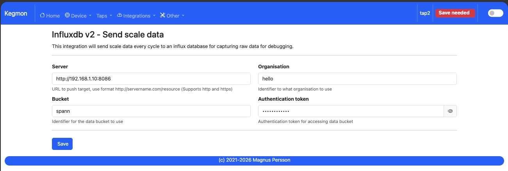

Configure InfluxDB v2 for logging scale and internal parameters. When enabled,
the firmware sends periodic data for all configured scales and records events.

Serial Console
**************

Access device logs for troubleshooting.

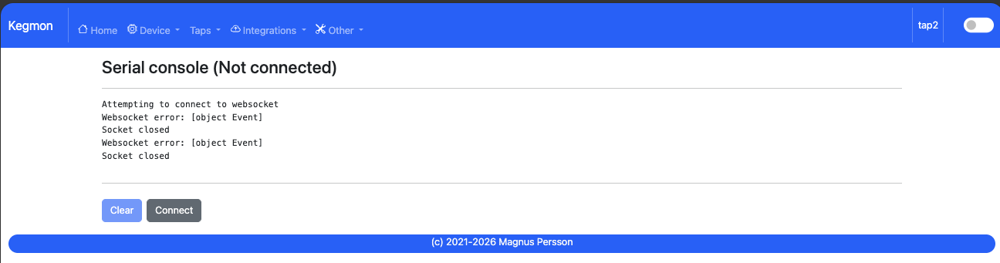

View real-time serial output from the device.

Backup & Recovery
*****************

Manage configuration backups.

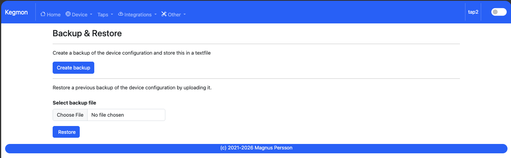

Create a backup file from the current settings or restore a KegMon backup file.
Restoring replaces the corresponding configuration fields and saves them to the
device, so keep a known-good backup before experimenting.

Firmware Update
***************

Update device firmware over-the-air.

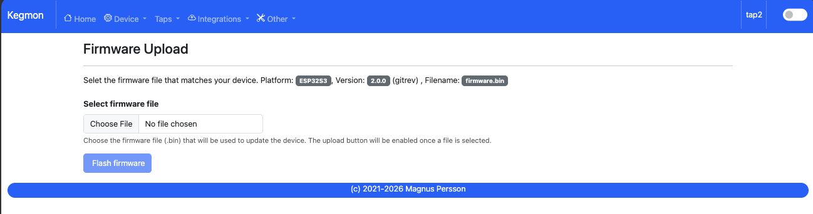

Upload the ``.bin`` firmware file that matches the device information shown on
the page. The device restarts after a successful upload.

Support
*******

Access diagnostic information.

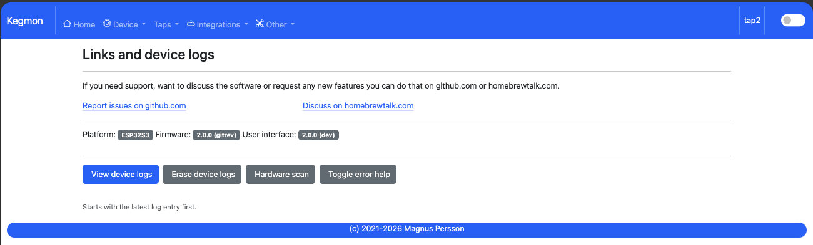

View logs and hardware details.

Tools
*****

Interact with the device's file system.

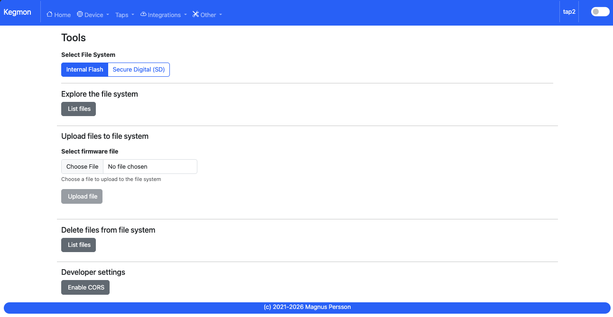

Manage files on the device.
